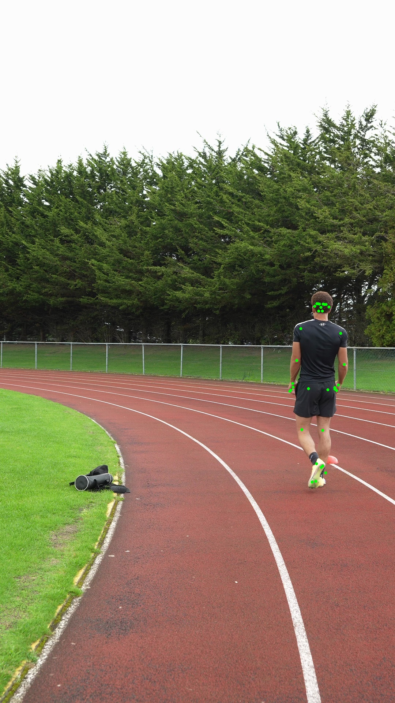

# Sprint Performance Analyzer

A computer-vision tool that analyses a sprinter's form from video and gives
feedback — built for athletes who train without a coach watching every session.

*33 body landmarks detected and connected into a skeleton overlay.*

## Why

Majority of the time sprinters have to rely on their own judgement when analysing their practice/ race performance 
when their coaches are unavailable. With this Analyzer it provides sprinters with advice / critique on their performance 
& showcases where they should improve on.

## Status

Early work in progress.

**Working now:** full-body pose skeleton overlay on a sprint video (MediaPipe
Pose + OpenCV) — detects and tracks 33 body landmarks per frame and renders the
skeleton onto an output video.

## Tech

- Python 3.13
- MediaPipe Pose (Tasks API) — pose estimation
- OpenCV — video I/O and drawing

## Setup

    git clone https://github.com/Flo1nn/Sprint-Performance-Analyzer.git
    cd Sprint-Performance-Analyzer

    python3 -m venv venv
    source venv/bin/activate        # important — see note below
    pip install -r requirements.txt

## Project structure

    main.py              CLI entry point
    sprint_analyzer/
        config.py        paths and tuning constants
        video.py         video I/O and validation
        pose.py          MediaPipe landmark detection
        draw.py          skeleton rendering
    data/                input videos (gitignored)
    output/              generated videos (gitignored)
    models/              MediaPipe pose model
    playground/          early exploration scripts

## Usage

1. Place a side view sprint video named `file.mp4` in `data/`.
2. Activate the venv: `source venv/bin/activate`
3. Run: `python main.py`
4. Open `output/out.mp4` to see the skeleton overlay.

To use different files, pass them as arguments:

    python main.py data/my_sprint.mp4 output/my_sprint_analysed.mp4

The script exits with a clear message if the video can't be opened, and warns
when the frame rate is below 120 fps — ground contact timing needs high frame
rates to be meaningful.

## Notes

- **Always activate the venv first.** MediaPipe is pinned to the `0.10.x`
  series — newer `1.0.x` versions crash on macOS (Apple Silicon). Running
  outside the venv can pick up a broken version.
- A side view camera angle is assumed — that's the view sprint mechanics
  (knee drive, trunk lean, ground contact) read from.

